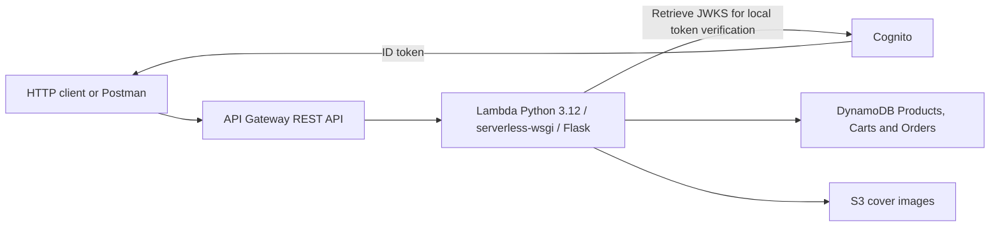
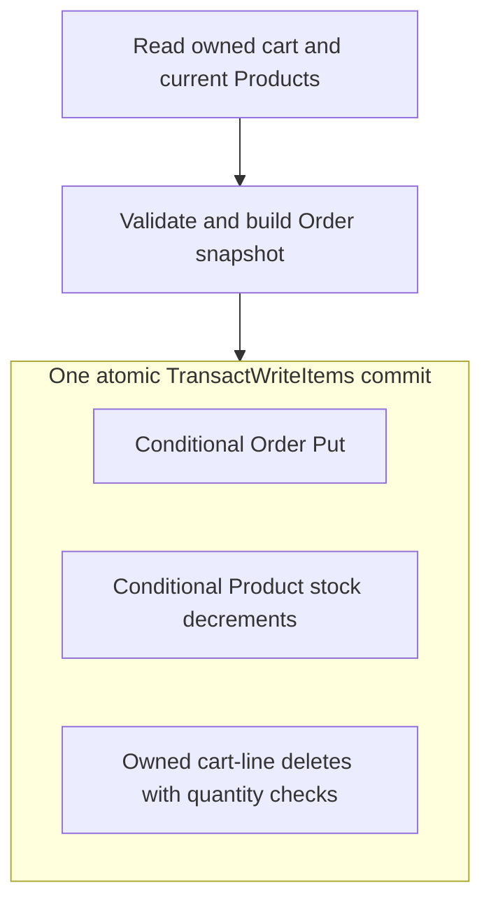

# Paperbound Backend Implementation Report

INFS803 Cloud Computing 2026 S2 Assignment 2 | Option B

Backend report contribution | 1 October 2026

Source repository: https://github.com/cloudvorkala/INFS803

Deployed API: https://8lvgv7w3l0.execute-api.ap-southeast-2.amazonaws.com/dev

## 1 Introduction and requirements analysis

Paperbound is an online bookshop whose backend manages a product catalogue, user-owned shopping carts, stock-controlled checkout, order history and cover-image uploads. The implementation uses AWS API Gateway, a Python Flask application in AWS Lambda, DynamoDB, Amazon S3 and Amazon Cognito. Twelve business REST operations are implemented, including four POST operations. The project owner has confirmed that all twelve operations are deployed to the shared dev stage. This chapter explains the backend design, cloud configuration, implementation and recorded validation; client interface design is outside its scope. [1, 3]

The main business risk is inconsistent purchasing state: a customer must not receive a successful order while inventory remains unchanged or only part of the cart is removed. A second concern is ownership: customers must not access another customer's cart or order history. These requirements lead to an atomic checkout transaction and partition-scoped queries using the verified Cognito subject. Public catalogue reads remain separate from protected customer and administrator operations.

Table 1 maps the backend contribution to the Option B requirements. The assignment accepts a serverless implementation and requires direct access to the backend without the web client; a three-tier design does not require three virtual machines. [1, pp. 6-8]

| Option B requirement | Paperbound backend response |
| --- | --- |
| Separate application and data tiers | API Gateway and Lambda host the REST application; managed DynamoDB stores business records. |
| At least 10 REST operations and 3 POST operations | 12 operations: 5 Products, 4 Cart, Checkout, Orders and Upload; 4 use POST. |
| Independently accessible cloud backend | Public HTTPS API base URL above; JSON calls can be made through Postman or curl. |
| Cloud database and asset storage | Existing Products, Carts and Orders tables; cover uploads stored in S3. |
| Document service access and implementation | Endpoint inventory, cloud configuration and API manual in this report; maintained reference in docs/api-reference.md. |
| Cloud engineering quality | Verified token claims, scoped IAM, conditional writes, atomic checkout and measured API latency. |

The catalogue design targets approximately 100 products. The recent public sample contains eight products; it is not evidence of performance at larger scale. Payment processing, refunds, fulfilment and production disaster recovery are outside the implemented business scope. Keeping these boundaries explicit avoids presenting a teaching deployment as a complete commercial commerce platform.

<!-- pagebreak -->

## 2 Architecture and backend structure

### 2.1 Cloud architecture

The client is an independent consumer of HTTPS JSON services. API Gateway REST API forwards both ANY / and ANY /{proxy+} to one Lambda handler. The handler calls serverless-wsgi, which adapts the request to Flask. Flask selects a route, verifies authentication where required, validates input and invokes a repository or service. The logical data tier comprises DynamoDB and S3. Cognito supplies identity; its JWT verification occurs inside Flask rather than an API Gateway authorizer. [3, 4]



Figure 1. Implemented backend request path and cloud dependencies. Arrows show access relationships; Cognito issues tokens separately from business API calls. The client is shown only as a backend consumer.

### 2.2 Separation of responsibilities

| Layer and source location | Responsibility |
| --- | --- |
| app.py and lambda_handler.py | Application assembly, CORS, body limit, cached WSGI application and Lambda adaptation. |
| routes/ and auth/ | HTTP methods, response statuses, verified identity and exact administrator-group checks. |
| models/ and http_helpers.py | Pydantic contracts, strict request validation and explicit JSON response serialization. |
| services/cart.py and services/checkout.py | Cart arithmetic, stock validation and purchase-time order snapshots. |
| services/uploads.py and repositories/ | Image checks, DynamoDB mapping, conditional persistence, transactions and S3 writes. |

Product and Order routes call their repositories directly where the operation does not need a separate service. Cart and Checkout coordinate several repositories through services. This avoids placing boto3 calls in route handlers while keeping the design proportionate to the application.

A single Lambda deployment reduces packaging and operational overhead, but all endpoints share its release cycle, timeout and execution-role permissions. It is not an independently deployed microservice per endpoint. This is a deliberate compromise for the current catalogue and team scope. Splitting services would be justified by measured scaling, isolation or release requirements, rather than by the REST endpoint count alone.

<!-- pagebreak -->

## 3 Persistence and data contracts

### 3.1 DynamoDB access model

The backend references existing application tables through configuration; it does not create their definitions in serverless.yml. Table design follows the access patterns rather than a relational join model. [3, 5]

| Table | Primary key | Backend access and purpose |
| --- | --- | --- |
| Paperbound-Products | Partition key id | Scan for the small catalogue; GetItem for detail and stock; conditional PutItem, UpdateItem and DeleteItem. |
| Paperbound-Carts | Partition key userId; sort key productId | Query one authenticated user; GetItem and conditional mutations for an individual line. |
| Paperbound-Orders | Partition key userId; sort key placedAtOrderId | Checkout transaction creates an order; Query returns the owner's history newest first. |

Cart rows store product identity and quantity rather than a trusted copy of product price or stock. Cart responses join these rows with current Product data in the application. Orders instead embed immutable checkout-time snapshots: productId, title, author, price, quantity and subtotal. Changing or deleting a Product therefore does not rewrite a past purchase.

The order sort key is an ISO timestamp followed by # and orderId. Query uses ScanIndexForward=False for descending history and follows LastEvaluatedKey. The sort key is not exposed in the public Order object. Product IDs use bk- plus UUID4 hex; order IDs use ord- plus UUID4 hex. Conditional creation protects against overwriting an existing key.

All Scan and Query paths consume every DynamoDB page. Carts and Orders query the user's partition; they never scan other users' rows. Public Product reads and Order history retain default eventual consistency. Cart reads, checkout product reads and Product update reads use strong consistency. These choices do not create a transaction-wide snapshot across separate reads; checkout conditions provide the final protection at commit time.

### 3.2 Validation and serialization

Pydantic Contract models reject unknown fields. Product responses expose exactly id, title, author, category, price, stock, isbn, publishedYear, coverUrl and description. Storage-only searchText is deliberately omitted. Response mapping also removes placedAtOrderId from Orders. [5, 6]

Money remains Decimal for repository writes and business calculations, then becomes a JSON number through model serializers. Stored integer fields are checked before conversion. Checkout uses 38-digit decimal precision and traps inexact calculations. The API does not prescribe a currency field or fixed two-decimal display, so the report does not infer either.

parse_json_request() maps invalid client models to 400. Internal mapping failures remain safe 500 errors. api_response() accepts a response Contract rather than an arbitrary DynamoDB dictionary, and the JSON provider rejects implicit Decimal or Pydantic conversion. This prevents numeric values silently becoming strings at the HTTP boundary.

<!-- pagebreak -->

## 4 REST API inventory and behaviour

Every path below is appended to this public base URL:

https://8lvgv7w3l0.execute-api.ap-southeast-2.amazonaws.com/dev

For example, GET /products uses https://8lvgv7w3l0.execute-api.ap-southeast-2.amazonaws.com/dev/products. Replace :id or :productId with an actual returned identifier. The two API Gateway ANY routes are transport mappings, not additional business operations. [4, 6]

| Method and path | Access | Success and purpose |
| --- | --- | --- |
| GET /products | Public | 200; {count, products}; optional category and search. |
| GET /products/:id | Public | 200; one Product. |
| POST /products | admins | 201; server-generated Product. |
| PUT /products/:id | admins | 200; partially updated Product. |
| DELETE /products/:id | admins | 200; {deleted: productId}. |
| GET /cart | Authenticated | 200; complete owned CartResponse. |
| POST /cart | Authenticated | 200; add or increment a line; return cart. |
| PUT /cart/:productId | Authenticated | 200; set quantity; zero deletes the line. |
| DELETE /cart/:productId | Authenticated | 200; delete owned line; return cart. |
| POST /checkout | Authenticated | 201; created Order after atomic commit. |
| GET /orders | Authenticated | 200; {count, orders}, newest first. |
| POST /upload_file | admins | 201; {url, s3Key} for an uploaded image. |

Product category matching is case-insensitive equality. Search is a case-insensitive substring over title, author and ISBN; combined filters use AND. Empty filters are ignored, repeated category/search parameters return 400, and the complete result is returned for client-side pagination. searchText is maintained on writes but the current search implementation evaluates the mapped fields directly.

Product creation requires trimmed, non-empty title, author and category, plus a finite non-negative numeric price. Stock defaults to zero and must be a non-negative integer. ISBN and description default to empty strings. publishedYear defaults to the current year and accepts zero or an integer from 1400 to 2100. coverUrl is nullable and an empty value normalizes to null. Update fields are optional; omitted means unchanged, only coverUrl accepts explicit null, and id is never writable.

Cart POST requires productId and defaults quantity to one. Quantities are strict integers: strings, booleans and fractions are rejected. POST and positive PUT require an existing Product and sufficient current stock. Missing cart lines return 404. GET /cart omits stale Product references and conditionally removes the observed stale rows. Product deletion itself never scans carts. Cart changes do not reserve inventory; Checkout must revalidate it.

<!-- pagebreak -->

## 5 Checkout atomicity and concurrency

Checkout derives the owner from verified Cognito sub, reads only that user's cart and strongly reads the referenced Products. It rejects an empty cart with 400, more than 40 unique lines with 400, a missing Product with 404 and insufficient stock with 409. Its request accepts only shippingAddress, whose fullName, line1, city, postcode and country must all be trimmed, non-empty strings. No mutation occurs during this preparation stage. [5, 6]

The service calculates each subtotal from current Product price multiplied by stored quantity, sums the total and constructs one CONFIRMED Order with a UTC timestamp. It then submits one TransactWriteItems operation containing a conditional Order Put, a Product Update per line and a Cart Delete per line. Forty lines require 1 + 40 + 40 = 81 actions. This is below DynamoDB's 100-action ceiling, although its transaction and item byte limits still apply. [9]



Figure 2. Checkout commit boundary. Preliminary reads are outside the transaction; all three categories of state change commit together or none commits.

The Product condition requires the item to exist, stock to remain sufficient, and price, title and author to match the snapshot used for the Order. Stock is decremented by the purchased quantity rather than replaced with a value calculated earlier. Each Cart deletion requires the row to exist and its quantity to match the observed quantity. Relevant condition failures and transaction conflicts become a safe 409 response: Checkout conflict. Refresh your cart and try again. Unexpected capacity, permission or other failures remain 500.

For two users requesting the last unit, at most one transaction can decrement stock from one to zero while satisfying the stock condition. A losing transaction cannot persist its Order or delete its cart line. This is a design property of the implemented conditions and atomic write, not a claim that every concurrent schedule has been observed in testing.

There is no application idempotency-key or cart-revision system. A new checkout request after a lost response is not guaranteed to reproduce the original outcome. A line changed and then restored to identical values is not detected, and newly added, unobserved lines remain in the cart. The API also performs no payment collection. These limits should be considered before extending the design to financial fulfilment.

<!-- pagebreak -->

## 6 Cloud implementation and deployment

### 6.1 Application deployment configuration

serverless.yml defines service paperbound-backend using Serverless Framework 4.22.0. The deployed application is reached through the dev URL; the repository configuration specifies the following settings. These are configuration values, not a fresh audit of the live AWS console. [4]

| Setting | Configured value |
| --- | --- |
| Region and runtime | ap-southeast-2; Python 3.12; x86_64 |
| Compute | One Lambda function api; handler lambda_handler.handler |
| Memory and timeout | 512 MB; 15 seconds |
| REST integration | ANY / and ANY /{proxy+}; serverless-wsgi dispatches to Flask |
| Logging | 14-day log retention |
| Dependency build | Docker using public.ecr.aws/sam/build-python3.12:latest-x86_64 |

The Docker build targets Lambda's Python and architecture even when deployment is initiated from Windows. requirements.txt includes Flask, boto3, python-dotenv, Pydantic, PyJWT with cryptographic support and serverless-wsgi. The WSGI adapter is called directly by the Lambda handler. The cached application instance survives warm invocations within one execution environment.

### 6.2 Existing resources and environment configuration

Deployment references the existing Cognito User Pool and App Client, three DynamoDB tables and uploads bucket. These application resources are not declared for recreation in the backend stack. Serverless manages a separate deployment artifact bucket; the application uploads bucket is not used for deployment packages.

COGNITO_USER_POOL_ID, COGNITO_APP_CLIENT_ID, PRODUCTS_TABLE, CARTS_TABLE, ORDERS_TABLE, UPLOADS_BUCKET, ALLOWED_ORIGINS, JWKS_CACHE_SECONDS and JWKS_TIMEOUT_SECONDS are forwarded to Lambda. AWS_REGION is supplied by Lambda itself. Local .env supports variable resolution and is excluded from the package alongside the virtual environment, tests and Node dependencies. Lambda accesses AWS through its execution role, not embedded access keys.

The deployment procedure is to select an authorised AWS profile, authenticate the pinned Serverless CLI, start Docker with its Linux engine, install Node dependencies using npm.cmd ci, and deploy from backend with the command below. This is an operator procedure, not a command executed while preparing this report.

```powershell
npx.cmd --no-install serverless deploy --stage dev --region ap-southeast-2
```

The latest project confirmation places all twelve operations on dev. Earlier Orders/Upload verification used orderstest with the same data resources, so the separate stage did not provide database isolation. The backend configuration does not establish an automated Git-triggered CI/CD pipeline; repeatable CLI deployment and automatic deployment are different capabilities.

<!-- pagebreak -->

## 7 Security and cloud storage

### 7.1 Identity and access control

Protected calls require Authorization: Bearer <Cognito ID token>. CognitoVerifier accepts RS256, selects a signing key from the configured pool's JWKS and validates signature, expiry, issuer, App Client audience and token_use=id. A valid non-empty sub determines ownership. The verified cognito:groups list must contain the exact string admins for Product mutations and Upload. Missing or invalid tokens produce 401; a valid non-admin token produces 403 on admin routes. [5, 10]

Client-supplied userId, role or group does not grant identity. Cart and Order queries construct the partition key from verified sub. Public Product routes do not require authentication, and the application does not implement duplicate login/register/logout services. Pydantic rejects extra request fields; errors use a JSON message envelope without returning raw AWS errors or token data.

| Lambda resource scope | Granted application actions |
| --- | --- |
| Configured Products table | Scan, GetItem, PutItem, UpdateItem, DeleteItem |
| Configured Carts table | Query, GetItem, UpdateItem, DeleteItem |
| Configured Orders table | Query; PutItem only when EnclosingOperation is TransactWriteItems |
| Upload bucket covers/uploads/* | s3:PutObject |

DynamoDB transaction members are authorised by their underlying item actions. No dynamodb:* or separate TransactWriteItems IAM grant is added. Product UpdateItem and Cart DeleteItem permissions cover those transaction members. Table indexes are not accessed or granted. CORS permits exact configured origins, including localhost for development; it is a browser rule, not a substitute for token validation. Allowed-origin OPTIONS returns 204 and a 300-second preflight lifetime. [4, 11]

### 7.2 S3 upload implementation

Upload accepts a filename and base64 dataUrl for JPEG, PNG or WebP. Validation enforces strict base64, a non-empty image and a decoded limit of 3 MiB; Flask limits the complete request body to 5 MiB. The service checks magic bytes against the declared type. This is a signature check, not full image decoding or malware scanning.

The service generates covers/uploads/img-<uuid4hex>.<extension>, writes through S3 PutObject and returns url and s3Key. The client filename never determines the storage path. Objects receive their Content-Type and a one-year immutable cache header because keys are unique. The response uses a regional S3 URL, not an implemented CloudFront distribution.

Recorded S3 configuration permits public GetObject on covers/* while retaining ACL blocking; upload writes remain role-controlled. The orderstest Postman run confirmed a returned image URL was readable. This public prefix is appropriate for catalogue covers, not private customer documents. Shipping addresses remain in authenticated Order records rather than public objects. [3]

<!-- pagebreak -->

## 8 Backend user manual

### 8.1 Independent access and common responses

Postman or curl can call the API without opening the frontend. Set BASE_URL to the deployed dev URL, use raw JSON and Content-Type: application/json for request bodies, and use Postman's Bearer Token mode for protected operations. Obtain a fresh Cognito ID token for an assigned test user; an administrator token must belong to admins. Keep tokens and credentials out of submitted screenshots and source files. The examples below are illustrative calls, not additional test results. [6]

```sh
BASE_URL='https://8lvgv7w3l0.execute-api.ap-southeast-2.amazonaws.com/dev'
curl "$BASE_URL/products?category=Fiction&search=writer"
curl "$BASE_URL/products/$PRODUCT_ID"
```

The list response is {"count": number, "products": [...]}; detail returns the Product directly. A missing Product returns 404 with {"message":"Product not found."}. Invalid input is 400, unauthenticated access 401, insufficient privileges 403, missing records 404 and business conflicts 409. Oversized request bodies return 413, unsupported body content types 415 and unexpected internal failures a safe 500. All business responses and Flask error envelopes use JSON.

### 8.2 Catalogue administration and carts

An administrator can create a disposable test Product using the first request. Save its returned id as PRODUCT_ID. Product PUT is partial: the second request changes stock while leaving other fields unchanged. DELETE /products/$PRODUCT_ID returns {"deleted":"<product-id>"} and should be used only for the intended disposable record.

```sh
curl -X POST "$BASE_URL/products" \
  -H "Authorization: Bearer $ADMIN_ID_TOKEN" \
  -H 'Content-Type: application/json' \
  --data '{"title":"Example Book","author":"Example Writer",
           "category":"Fiction","price":19.99,"stock":5}'

curl -X PUT "$BASE_URL/products/$PRODUCT_ID" \
  -H "Authorization: Bearer $ADMIN_ID_TOKEN" \
  -H 'Content-Type: application/json' --data '{"stock":6}'
```

As a normal authenticated user, POST /cart with {"productId":"<returned-id>","quantity":2} adds two units. A repeated POST increments the line. PUT /cart/:productId with {"quantity":1} sets one unit; zero removes it. GET /cart and both mutation forms return the complete cart. DELETE removes only that user's selected line.

An illustrative single-line cart at price 19.99 and quantity two has the response below. itemCount counts units, not distinct lines. Product details are resolved by the backend, so they are not submitted in the cart request.

```json
{"items":[{"productId":"<returned-id>","title":"Example Book",
 "author":"Example Writer","price":19.99,"stock":6,
 "quantity":2,"subtotal":39.98}],"itemCount":2,"total":39.98}
```

<!-- pagebreak -->

### 8.3 Checkout and order history

Prepare a non-empty cart with available stock, then submit the shipping address with the same user's ID token. The request has no userId, total or Product details. The backend calculates authoritative values and returns 201 only after transaction success.

```sh
curl -X POST "$BASE_URL/checkout" \
  -H "Authorization: Bearer $USER_ID_TOKEN" \
  -H 'Content-Type: application/json' \
  --data '{"shippingAddress":{"fullName":"Example Reader",
    "line1":"1 Example Road","city":"Auckland",
    "postcode":"1010","country":"New Zealand"}}'

curl "$BASE_URL/orders" -H "Authorization: Bearer $USER_ID_TOKEN"
```

The following illustrates the Order shape for two units at 19.99. The server supplies the identity, timestamp and identifier. GET /orders wraps Order objects in {"count": number, "orders": [...]} and sorts them newest first.

```json
{
  "orderId":"ord-<server-generated-uuid>",
  "userId":"<verified-cognito-sub>",
  "placedAt":"2026-10-01T00:00:00Z",
  "status":"CONFIRMED",
  "shippingAddress":{
    "fullName":"Example Reader","line1":"1 Example Road",
    "city":"Auckland","postcode":"1010","country":"New Zealand"
  },
  "items":[{"productId":"<returned-id>","title":"Example Book",
    "author":"Example Writer","price":19.99,
    "quantity":2,"subtotal":39.98}],
  "total":39.98
}
```

An empty cart returns 400, an unavailable Product returns 404 and insufficient stock or a conflicting transaction returns 409. Refresh the cart before retrying a business conflict. If the network loses a response, inspect order history before starting another checkout; the API does not implement request-level checkout idempotency. Order history is eventually consistent, so an immediately missing entry is not definitive evidence that the commit failed.

### 8.4 Image upload

In Postman, send POST /upload_file with an admin Bearer token and a JSON body containing filename and dataUrl. Supply real base64-encoded JPEG, PNG or WebP content within the decoded size limit. The response is {"url":"https://<bucket>.s3.ap-southeast-2.amazonaws.com/covers/uploads/img-<uuid>.png","s3Key":"covers/uploads/img-<uuid>.png"}. Use the returned URL as coverUrl in a Product create or update request. Uploading an object does not itself update a Product or delete an older cover.

These manual procedures write real dev data. Dedicated test accounts and clearly identified disposable records keep normal catalogue, cart and order state separate from verification fixtures. The public catalogue remains accessible without any credentials.

<!-- pagebreak -->

## 9 Verification and performance evidence

### 9.1 Recorded functional validation

Verification must distinguish implementation, local checks and cloud execution. The evidence below is recorded in docs/current-status.md; preparing this report did not repeat deployments, create orders or run load tests. [3]

| Area | Recorded evidence and boundary |
| --- | --- |
| Products | User-reported AWS CRUD verification, Cognito admin access, real table reads/writes and JSON numeric output. |
| Cart | User-reported local and AWS verification, including isolation between two Cognito users. |
| Checkout | User-reported AWS deployment and testing; complete concurrency and edge-case results not recorded. |
| Orders and Upload | orderstest Postman run: 17 requests, 30/30 assertions, including ownership, admin checks and public image retrieval. All endpoints later reported deployed to dev; authenticated retest there not recorded. |
| Local regression | Existing suite: 143 passed and 3 failed. Two old tests expect /products to be absent; one expects no IAM policy. The suite is not fully passing. |
| SDK optimisation | Offline checks of lazy initialisation, thread isolation, reuse, failure recovery, CORS and transaction encoding. |

The existing k6 script defines two correctness scenarios. The race case sends two users' checkouts for one stock unit and checks one 201, one 409, zero remaining stock, one new persisted order, the winner's cleared cart and the loser's retained line. The rollback case prepares two lines, reduces one Product's stock before checkout, and checks that rejection leaves both cart lines, the other stock value and order count unchanged. [7]

The second case principally exercises prevalidation failure, since stock is already insufficient before the transaction. It does not prove cancellation after a concurrent mutation. Test code and expected assertions are not execution evidence; no preserved successful run of these two cases is claimed here.

### 9.2 Observed cloud API latency

| Product list measurement | Initial observation | Follow-up observation |
| --- | --- | --- |
| Individual requests in milliseconds | 577, 499, 479, 431 | 80, 75, 99, 72, 75, 69 |
| Mean | 496.5 ms | 78.3 ms |
| Payload | 8 Products; 1,874 bytes | 8 Products; 1,874 bytes |

The follow-up requests all returned 200. Client-side timing included downloading the response body; the observed mean was approximately 84% lower. OPTIONS returned 204 with the correct origin and Access-Control-Max-Age: 300. These small samples were not controlled for memory, network conditions, cold starts or instance reuse. OPTIONS preceded the later GETs. They demonstrate observed HTTP latency, not a causal benchmark, concurrent-load capacity, Lambda execution time or complete page rendering speed.

<!-- pagebreak -->

## 10 Engineering evaluation and reflection

### 10.1 Performance and scalability

The initial implementation constructed a boto3 Session and DynamoDB resource for each operation. repositories/dynamodb.py now lazily reuses a session, table handles and connection pools per application worker thread. The cached Lambda application can retain them for warm invocations. Checkout uses a separate low-level client because its transaction values are already explicitly serialized. Records and responses are not cached, so reuse does not introduce a stale stock cache. This applies execution-environment reuse without storing customer identity in a shared global variable. [5, 12]

The full catalogue Scan is proportionate to the present design but its read cost and response size grow with catalogue size. Cart and Checkout also make individual Product lookups, so work grows with line count. A larger catalogue would justify reviewing access patterns, batch reads, indexing and a coordinated pagination contract. Managed services offer a path to scale, but account quotas, database capacity and shared-Lambda concurrency still require measurement. No load-capacity or zero-cold-start guarantee is made.

### 10.2 Reliability and operational limits

Conditional writes prevent selected lost-update cases; checkout commits inventory, order and cart changes together. The read-before-write conditions do not detect a stale administrator form before the request starts. Service-side atomicity also does not provide regional disaster recovery or recover a lost HTTP success response. Current source configuration establishes neither cross-region replication nor verified backup restoration, point-in-time recovery, alarms or an incident runbook. These are priorities for production hardening rather than features already delivered.

The shared orderstest and dev data resources are a further operational limit. A separate API stage alone is insufficient isolation for destructive or high-volume tests. Dedicated tables, accounts or rigorously isolated fixtures would be needed before broader testing.

### 10.3 Cost and security tradeoffs

The design avoids managing an always-running application VM and reuses existing managed resources. Actual cost depends on API calls, Lambda duration and memory, DynamoDB operations and storage, S3 requests and transfer, Cognito usage and logs. Transactions, strong reads and full scans have different capacity implications. No measured monthly bill, free-tier eligibility or DynamoDB billing mode is asserted. A 512 MB setting should be evaluated using both duration and cost, not latency alone.

Future priorities are to align the three obsolete tests, preserve repeatable cloud regression evidence, introduce checkout idempotency, review image validation beyond magic bytes, and verify backups and monitoring. Dependency ranges also warrant reproducible pinning or a controlled build process. Public cover delivery should stay restricted to non-sensitive assets.

### 10.4 Conclusion

Paperbound demonstrates a deployed serverless backend with independently callable REST APIs, managed database persistence, cloud asset storage and verified identity-based access. Its strongest reliability decision is treating checkout as one conditional transaction. The performance work illustrates that SDK lifecycle management can remove repeated setup work without weakening consistency. Production readiness would require broader operational evidence and recovery controls; it should not be inferred from endpoint availability alone.

<!-- pagebreak -->

## 11 References and backend evidence index

[1] Auckland University of Technology. (2026). INFS803 Cloud Computing 2026 S2 Assignment 2. Supplied assignment brief. Option B requirements: PDF pages 6-8; assessment rubric: pages 9-11.

[2] Example Project Report - Streamin Along - For Choice B. (n.d.). Supplied example report. Relevant organisation: architecture and layering, backend design, database design, technologies and atomic-service URL list. Used as a structural reference, not evidence of Paperbound's implementation.

[3] Paperbound project. (2026). docs/current-status.md. Recorded implementation, deployment, Postman results, local regression results and live HTTP observations. Repository inspected on 1 October 2026.

[4] Paperbound project. (2026). backend/serverless.yml, backend/app.py, backend/lambda_handler.py, backend/config.py and backend/requirements.txt. Deployment and runtime configuration.

[5] Paperbound project. (2026). backend/auth/, backend/services/, backend/repositories/ and backend/models/. Authentication, business logic, persistence, transaction and validation implementation.

[6] Paperbound project. (2026). docs/api-contract.md and docs/api-reference.md. Contract and maintained REST usage reference. Dated foundation-status paragraphs in the contract are historical; current implementation is recorded in the reference and status document.

[7] Paperbound project. (2026). backend/test-checkout.js, backend/test-checkout.md, backend/run-checkout-test.ps1 and backend/tests/. Test design and local verification tooling; script existence is not a successful cloud run.

[8] Paperbound source repository. https://github.com/cloudvorkala/INFS803

[9] Amazon Web Services. (n.d.). Amazon DynamoDB Transactions: How it works. Accessed 1 October 2026. https://docs.aws.amazon.com/amazondynamodb/latest/developerguide/transaction-apis.html

[10] Amazon Web Services. (n.d.). Understanding the identity ID token. Accessed 1 October 2026. https://docs.aws.amazon.com/cognito/latest/developerguide/amazon-cognito-user-pools-using-the-id-token.html

[11] Amazon Web Services. (n.d.). Using IAM with DynamoDB transactions. Accessed 1 October 2026. https://docs.aws.amazon.com/amazondynamodb/latest/developerguide/transaction-apis-iam.html

[12] Amazon Web Services. (n.d.). Best practices for working with AWS Lambda functions. Accessed 1 October 2026. https://docs.aws.amazon.com/lambda/latest/dg/best-practices.html

### Backend demonstration evidence

For assessment, pair the implementation with API Gateway route and Lambda configuration captures, redacted Postman request/response evidence, DynamoDB key and persisted-order captures, and an S3 upload plus retrieval example. Maintain a separate record of successful race and rollback runs when executed. Existing recorded results support the specific claims in Section 9; these further captures should not be substituted with illustrative JSON or invented console screenshots.

Keep the backend URL available through the marking period, and provide approved access for authenticated and admin demonstrations without publishing reusable secrets. This backend contribution does not replace the complete group submission's member contributions, project-management evidence, presentation link, client coverage or AI Usage Declaration required by the assignment.
